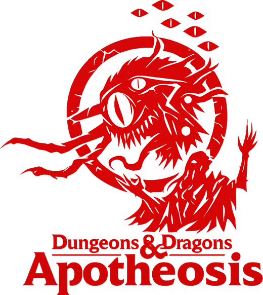
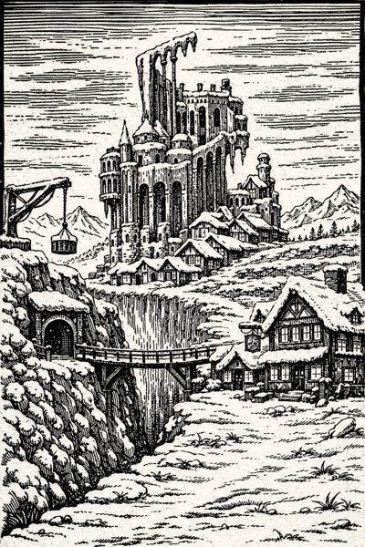
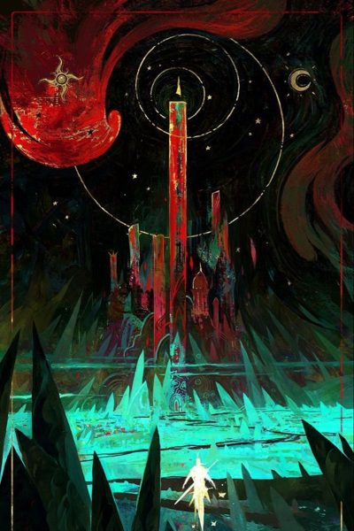
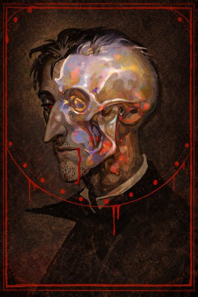

  

  <em>A homebrew Dungeons &amp; Dragons setting, campaign, and ruleset</em> 
  by The Charred Eye

  
  
  

---

> *"You're the greatest project you will ever work on..."*
>  — Father Indorilius

## The World

The known world turns on the golden domes of **Romulon**, seat of the high elves and heart of the Church. Its faith claims to hold up the very structure of reality, and few who kneel there ask what lies beneath it.

Far from that light, in the snowbound north, the hamlet of **Forgelight** clings to the ruins of an ancient snow-elven temple, digging into a past that was buried for a reason. And on the king's roads between them, a host in **black iron** marches, burning everything in its path.

A priest with a secret mission, a rogue with a voice inside her head, and a stranger with a blade drawn from his own blood are about to meet in a tavern at the edge of the first snow. What they are looking for, and what is looking for them, is for the table to find out.

  
  &nbsp;
  
  &nbsp;
  

## What's Inside

**Apotheosis** is a dark fantasy campaign built on fifth edition, with its own lore, peoples, and rules that lean into consequence and story.

| | |
| :-- | :-- |
| **Homebrew rules** | Tiered travel, class divergence, critical roll effects, group rolls, and the *Act of Valour* and *Heroic Death* options for when a character refuses to fall. |
| **Gestalt characters** | A high-powered variant where small parties advance in two classes at once. |
| **Species** | Reimagined elves, dwerfen, orqs, golyaths, drakeborn, seraphs, tieflings and more, plus half-blood and variant species such as the Dhampir, Chymaera, and Reborn. |
| **Religions** | Rival faiths tied to the pillars of reality, each with its own domain, clergy, and history of holy war. |
| **Afflictions** | Diseases, curses and transformations, from lyrium and red rot to lycanthropy and vampirism. |
| **Magic** | Four sources of power: synthetic, occult, divine, and natural. |
| **Bestiary** | Original monsters and a playable monster class. |

## Playing

The campaign uses a **hybrid of the 2014 and 2024 Player's Handbooks**. Players should read the homebrew rules and species chapters before building a character; the rest of the world reveals itself in play.

> [!NOTE]
> Apotheosis is in **alpha**. Rules and lore change between sessions, and some chapters are still being written.

## Repository

The campaign book and session recaps are typeset in LaTeX with a clean, minimalist dark fantasy look, and will be published here as they reach a playable state. Art lives in the `assets/` folder.

## Credits & License

Written and run by **The Charred Eye**. Released under the [MIT License](LICENSE).

*Apotheosis* is unofficial fan content. Dungeons &amp; Dragons is a trademark of Wizards of the Coast; this project is not affiliated with or endorsed by them.
