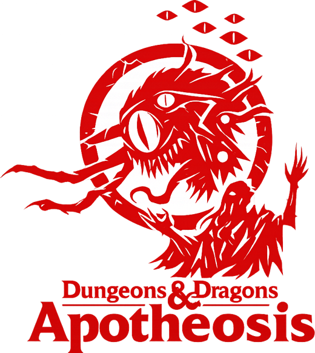
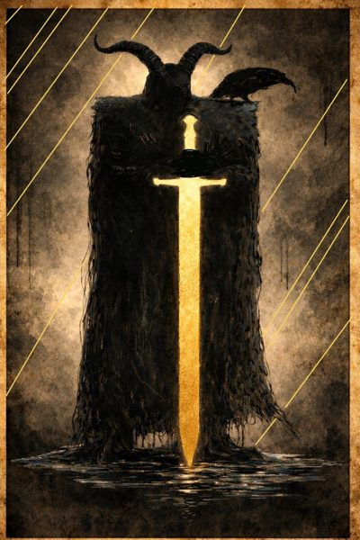
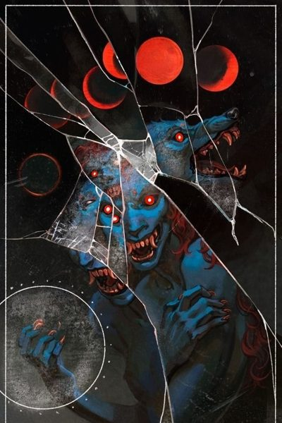
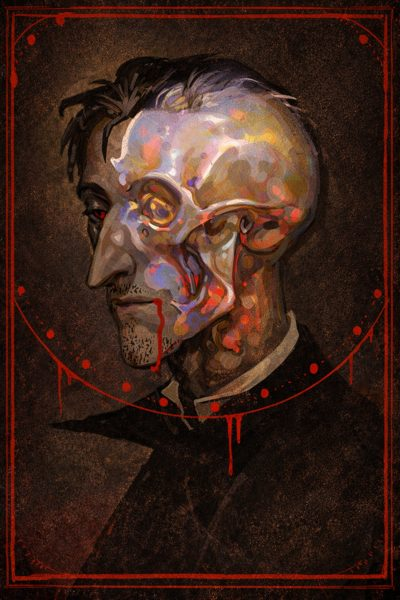

  

  <em>A homebrew Dungeons &amp; Dragons setting, campaign, and ruleset</em> 
  T H E &nbsp; C H A R R E D &nbsp; E Y E

  <a href="https://shimji-ee.github.io/Apotheosis/"><strong>Visit the website →</strong></a>

  
  
  

---

<b>“YOU'RE THE GREATEST PROJECT YOU WILL EVER WORK ON…”</b> FATHER INDORILIUS

## ✦ Part I · The World

Apotheosis is a hard, cold land of muddy roads, burning villages and church bells that toll too often. Lords squabble over borders, priests sell salvation by the coin, and in the forests past the last fence, things older than any crown still hunt.

Here monsters wear faces as often as fangs, every bargain is paid in blood or silver, and an honest choice is rarely a clean one. Those who walk these roads come back scarred, if they come back at all, and what they become is for the table to find out.

  
  &nbsp;
  
  &nbsp;
  

## ✦ Part II · What's Inside

**Apotheosis** is a dark fantasy campaign built on fifth edition, with its own lore, peoples, and rules that lean into consequence and story.

| | |
| :-- | :-- |
| **Homebrew Rules** | Tiered travel, class divergence, critical roll effects, group rolls, and the *Act of Valour* and *Heroic Death* options for when a character refuses to fall. |
| **Gestalt Characters** | A high-powered variant where small parties advance in two classes at once. |
| **Species** | Reimagined elves, dwerfen, orqs, golyaths, drakeborn, seraphs, tieflings and more, plus half-blood and variant species such as the Dhampir, Chymaera, and Reborn. |
| **Religions** | Rival faiths tied to the pillars of reality, each with its own domain, clergy, and history of holy war. |
| **Afflictions** | Diseases, curses and transformations, from lyrium and red rot to lycanthropy and vampirism. |
| **Magic** | Four sources of power: synthetic, occult, divine, and natural. |
| **Bestiary** | Original monsters and a playable monster class. |

## ✦ Part III · Playing

The campaign uses a **hybrid of the 2014 and 2024 Player's Handbooks**. Players should read the homebrew rules and species chapters before building a character; the rest of the world reveals itself in play.

> [!NOTE]
> Apotheosis is in **alpha**. Rules and lore change between sessions, and some chapters are still being written.

## Repository

The campaign book is typeset in LaTeX with a clean, minimalist dark fantasy look, and will be published here as they reach a playable state. Art lives in the `assets/` folder.

## Credits & License

Written and run by **The Charred Eye**.

Copyright © 2026 Charl (The Charred Eye). **All rights reserved.** The setting, story, and homebrew rules in this repository may not be copied, adapted, or published elsewhere without written permission. See [LICENSE](LICENSE) for the full terms.

This work includes material from the System Reference Document 5.1 and 5.2 by Wizards of the Coast LLC, licensed under [CC-BY-4.0](https://creativecommons.org/licenses/by/4.0/legalcode). That material stays under its own licence.

*Apotheosis* is unofficial fan content. Dungeons &amp; Dragons is a trademark of Wizards of the Coast; this project is not affiliated with or endorsed by them.
