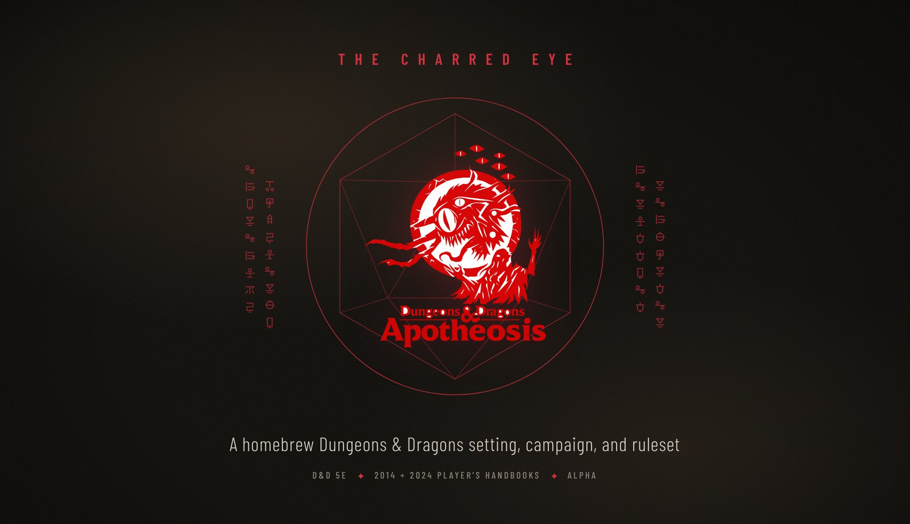
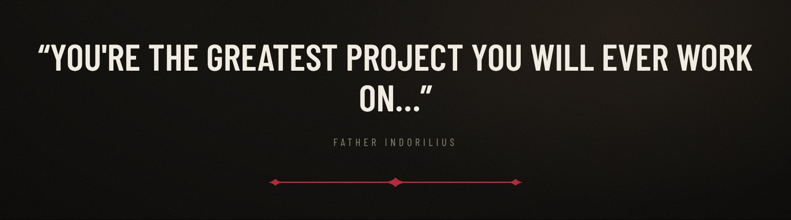
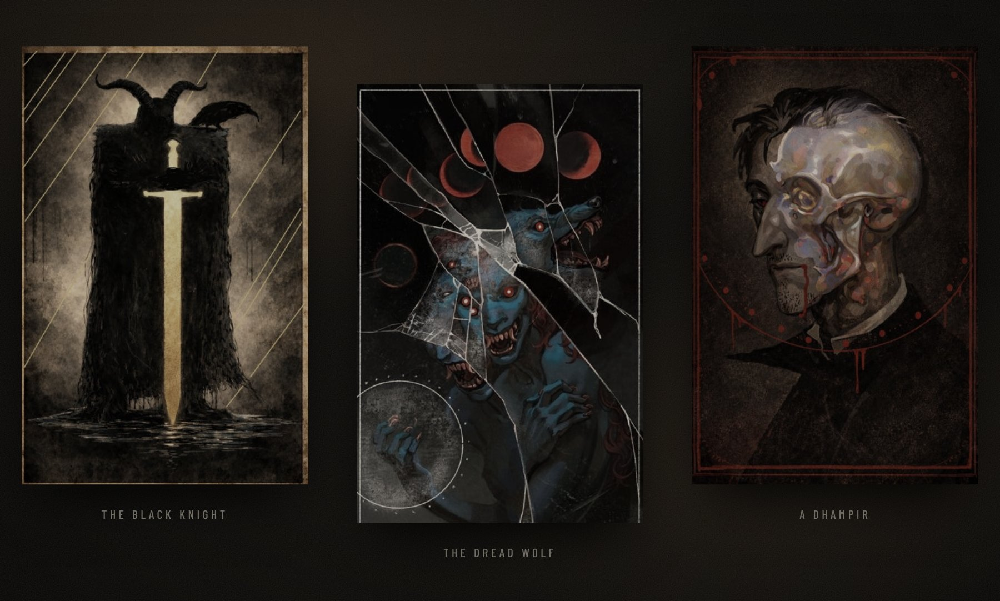
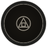

  

  

  
  
  

  

 

### Romulon
THE GOLDEN DOMES

The known world turns on its golden domes, seat of the high elves and heart of the Church. Its faith claims to hold up the very structure of reality, and few who kneel there ask what lies beneath it.

### Forgelight
THE SNOWBOUND NORTH

Far from that light, in the snowbound north, a hamlet clings to the ruins of an ancient snow-elven temple, digging into a past that was buried for a reason.

### Black Iron
THE KING'S ROADS

And on the king's roads between them, a host in black iron marches, burning everything in its path.

> *A priest with a secret mission, a rogue with a voice inside her head, and a stranger with a blade drawn from his own blood are about to meet in a tavern at the edge of the first snow. What they are looking for, and what is looking for them, is for the table to find out.*

  

 

***Apotheosis*** is a dark fantasy campaign built on fifth edition, with its own lore, peoples, and rules that lean into consequence and story.

<table>
  <tr>
    <td width="64" align="center"></td>
    <td><b>HOMEBREW RULES</b> Tiered travel, class divergence, critical roll effects, group rolls, and the <i>Act of Valour</i> and <i>Heroic Death</i> options for when a character refuses to fall.</td>
  </tr>
  <tr>
    <td align="center"></td>
    <td><b>GESTALT CHARACTERS</b> A high-powered variant where small parties advance in two classes at once.</td>
  </tr>
  <tr>
    <td align="center"></td>
    <td><b>SPECIES</b> Reimagined elves, dwerfen, orqs, golyaths, drakeborn, seraphs, tieflings and more, plus half-blood and variant species such as the Dhampir, Chymaera, and Reborn.</td>
  </tr>
  <tr>
    <td align="center"></td>
    <td><b>RELIGIONS</b> Rival faiths tied to the pillars of reality, each with its own domain, clergy, and history of holy war.</td>
  </tr>
  <tr>
    <td align="center"></td>
    <td><b>AFFLICTIONS</b> Diseases, curses and transformations, from lyrium and red rot to lycanthropy and vampirism.</td>
  </tr>
  <tr>
    <td align="center"></td>
    <td><b>MAGIC</b> Four sources of power: synthetic, occult, divine, and natural.</td>
  </tr>
  <tr>
    <td align="center"></td>
    <td><b>BESTIARY</b> Original monsters and a playable monster class.</td>
  </tr>
</table>

 

The campaign uses a **hybrid of the 2014 and 2024 Player's Handbooks**. Players should read the homebrew rules and species chapters before building a character; the rest of the world reveals itself in play.

&nbsp; Rules and lore change between sessions, and some chapters are still being written.

#### The repository

The campaign book and session recaps are typeset in LaTeX in the same dark Grave Red style as the website, and will be published here as they reach a playable state. The website lives in `docs/` and art lives in `assets/`.

 

  

  

  Written and run by <b>The Charred Eye</b>.

  Copyright &copy; 2026 Charl (The Charred Eye). <b>All rights reserved.</b> 
  The setting, story, and homebrew rules in this repository may not be copied, adapted, or published elsewhere without written permission. 
  See the <a href="LICENSE">licence</a> for the full terms.

  This work includes material from the System Reference Document 5.1 and 5.2 by Wizards of the Coast LLC, licensed under <a href="https://creativecommons.org/licenses/by/4.0/legalcode">CC-BY-4.0</a>. That material stays under its own licence. 
  <i>Apotheosis</i> is unofficial fan content. Dungeons &amp; Dragons is a trademark of Wizards of the Coast; this project is not affiliated with or endorsed by them.

